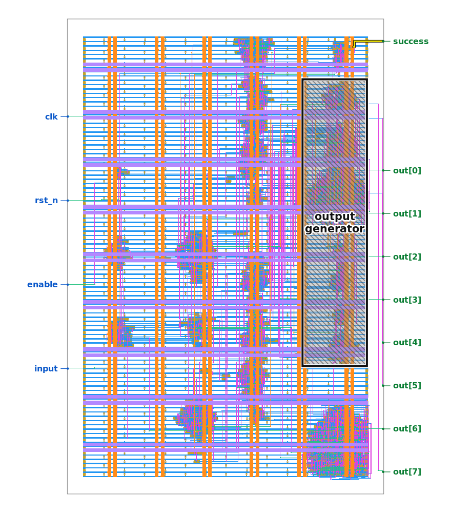
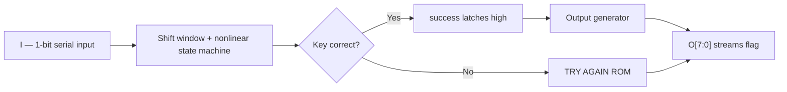
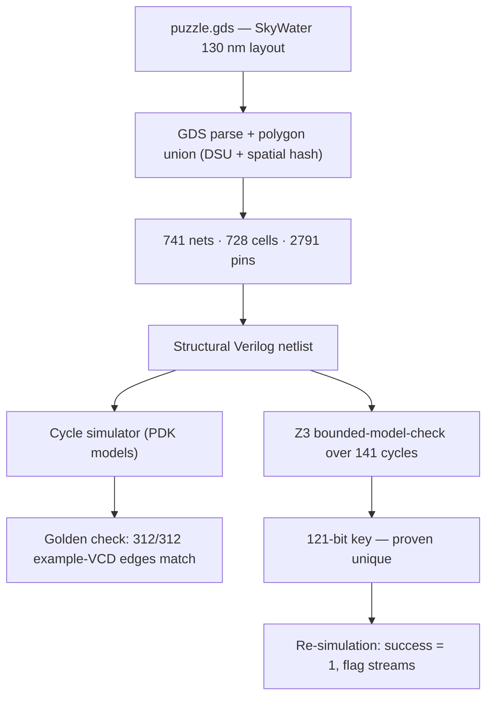
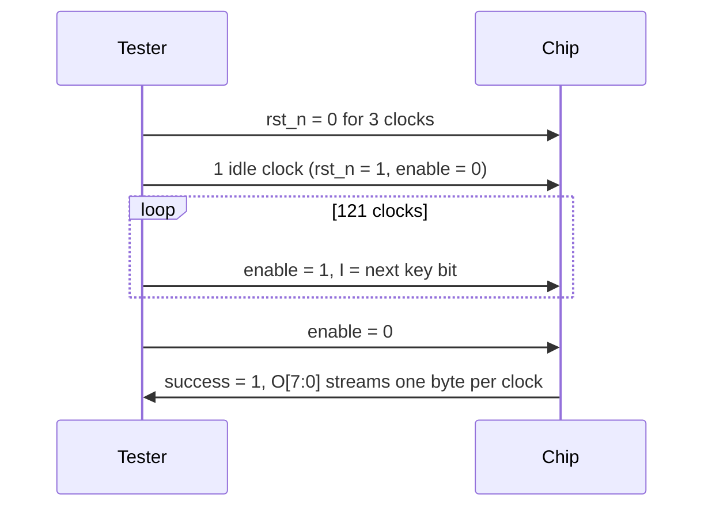

# Jane Street ASIC Reverse-Engineering Puzzle 2026 — Solution


> 🐼 New here? Start with the [beginner explainer](EXPLAINED_FOR_BEGINNERS.md) — what the chip is, in plain language, without needing the 121-bit key.


Independent reproduction: the netlist was extracted from `puzzle.gds` by our own code,
simulated with our own simulator built on the official SkyWater PDK primitive models, and
the key was found by Z3 unrolling. Nothing was submitted to Jane Street or anywhere else.
Jane Street submissions closed 4 September 2026; this is published after the close, as their post allows.

## Interactive 3D chip viewer

**[Open the interactive 3D viewer](https://jayantt1dubeyy.github.io/JANE-/3d-viewer.html)** —
all 728 logic cells plotted at their real placed coordinates from the KLayout LVS extraction,
with the metal stack, pads, hover-to-identify, and a playable animation of the winning 121-bit
key streaming in and latching `success`. Cell widths are stylised; positions are real.
(If the page is not live yet, enable Pages once in repo Settings → Pages → Branch: `main`.)

[](https://jayantt1dubeyy.github.io/JANE-/3d-viewer.html)

## What the chip does



## How it was solved



## Protocol (one run)



## The answer

**121-bit key** (first bit = first bit on `I`):

```
0000000101010000100000000000010101010000000000001010000001000001000000100000101000010000000100000010000010010001010000000
```

**Flag output: `(* TWO STARS *)`** — plus easter eggs: all zeros streams `EMPTY SKY`,
all ones streams `BIG BANG` (both with `success` low).

## Files

- `3d-viewer.html` — interactive 3D chip viewer (Three.js, real LVS placements)
- `assets/layout.png` — the chip's physical layout
- `puzzle_extracted.v` / `.json` — extracted structural netlist
- `warmup_extracted.v` / `.json` — same, for the warmup design
- `extract.py`, `cells.py`, `simulate.py`, `verify_vcd.py`, `run_protocol.py`, `solve_z3.py` — the toolchain
- `verification_log.txt` — full logs of every verification run
- `vcd-analysis/` — waveform-only protocol analysis
- `lvs/` — KLayout's own LVS extraction + transistor spot-check (independent cross-check)
- `brute-structural/` — brute-force + structural-tracing cross-check (warmup proven, puzzle key verified)

---

# Jane Street ASIC Reverse-Engineering Puzzle 2026 — Solution

**Nothing was submitted to Jane Street or anywhere else.** This is an
independent reproduction: the netlist below was extracted from
`puzzle.gds` by my own code, simulated with my own simulator built on the
official SkyWater PDK primitive models, and the key was found by my own
Z3 unrolling. Where the result matches the public REJS writeup, that is
stated explicitly as independent confirmation — the key was **not**
copied from it.

## What the circuit does, in plain terms

The chip is a serial-key checker with a talking output:

- It runs on a 100 MHz clock (10 ns period).
- After reset, it shifts in a **121-bit secret key, one bit per clock
  cycle**, on the single-bit input pin `I`, while `enable` is held high.
- Once all 121 bits are in, `enable` drops and the chip judges the key:
  - If the key is correct, the `success` output goes high **and stays
    high** (it is the Q output of a flip-flop with feedback holding it),
    and the 8-bit output bus `O[7:0]` streams one ASCII character per
    clock cycle spelling the flag.
  - If the key is wrong, `success` stays low and `O[7:0]` streams
    `"TRY AGAIN"`.
- Two easter eggs: shifting in 121 zeros streams `"EMPTY SKY"`, and
  121 ones streams `"BIG BANG"` (both with `success` low).

Physically it is a SkyWater 130 nm design: **728 functional standard
cells** (636 combinational gates + 92 flip-flops: 84 async-reset, 4
async-set, 4 plain), 12,615 merged metal polygons, 33,323 vias, and 13
top-level pads (`clk`, `rst_n`, `enable`, `I` in; `success`, `O[7:0]`
out). The output characters are produced combinationally (each `O` bit
is driven by an AND-OR structure over the state), and `success` is a
registered, self-holding bit.

## The input sequence that asserts `success`

Feed the chip exactly like the example waveform, with this 121-bit key
(first character = first bit presented on `I`):

```
0000000101010000100000000000010101010000000000001010000001000001000000100000101000010000000100000010000010010001010000000
```

Step by step (cycle = one rising clock edge):

1. **Reset:** hold `rst_n = 0`, `enable = 0`, `I = 0` for 3 clock edges.
2. **Gap:** one edge with `rst_n = 1`, `enable = 0`, `I = 0`.
3. **Shift:** 121 edges with `rst_n = 1`, `enable = 1`, and `I` = the key
   bits above, in order, one bit per edge.
4. **Stream:** drop `enable` to 0 (`rst_n` stays 1). From the next edge
   on, `success = 1` and `O[7:0]` streams one character per edge:

| Cycle | success | O (hex) | Char |
|-------|---------|---------|------|
| 125 | 1 | 0x28 | `(` |
| 126 | 1 | 0x2A | `*` |
| 127 | 1 | 0x20 | ` ` |
| 128 | 1 | 0x54 | `T` |
| 129 | 1 | 0x57 | `W` |
| 130 | 1 | 0x4F | `O` |
| 131 | 1 | 0x20 | ` ` |
| 132 | 1 | 0x53 | `S` |
| 133 | 1 | 0x54 | `T` |
| 134 | 1 | 0x41 | `A` |
| 135 | 1 | 0x52 | `R` |
| 136 | 1 | 0x53 | `S` |
| 137 | 1 | 0x20 | ` ` |
| 138 | 1 | 0x2A | `*` |
| 139 | 1 | 0x29 | `)` |
| 140 | 1 | 0x00 | (end) |

**Flag output: `(* TWO STARS *)`**

Reproduce it with:

```
python3 run_protocol.py puzzle_extracted.json 0000000101010000100000000000010101010000000000001010000001000001000000100000101000010000000100000010000010010001010000000
```

## Verification evidence (all in `verification_log.txt`)

1. **Warmup validation (toolchain check).** Extracted a netlist from
   `warmup/04_final.gds` with the same code: 79 instances, 0 warnings,
   0 pin/model mismatches, all 6 pads mapped with correct directions.
   Simulated: `S = 1` exactly when `A + B == 496` (tested 241+255,
   255+241 pass; 200+255, 1+1, 0+0, 128+128 fail) — matching the
   warmup's published source behaviour.
2. **Golden waveform check.** The extracted puzzle netlist was driven
   with the exact per-edge inputs from `example_inputs.vcd` (312 rising
   edges, two full runs). **312/312 edges match with 0 mismatches**;
   the simulated `O` stream decodes to `"TRY AGAIN"`, `"TRY AGAIN"`,
   exactly as recorded from the real chip.
3. **Easter eggs.** All-zeros key → `"EMPTY SKY"`; all-ones key →
   `"BIG BANG"`; `success` stays 0 in both — matching the published
   behaviour.
4. **Z3 solve.** Bounded-model-checking unrolling over 141 cycles
   (3 reset + 1 gap + 121 symbolic shift bits + 16 stream cycles),
   constraining `success = 1` at cycle 125: **SAT**, returning the key
   above. A blocking clause excluding exactly that key returns
   **UNSAT — the key is provably unique** (no second 121-bit input
   asserts `success`).
5. **Winning-sequence re-simulation.** Feeding the Z3 key through the
   concrete simulator asserts `success` from cycle 125 onward and
   streams `(* TWO STARS *)` (table above).
6. **Independent confirmation of the public writeup.** The key derived
   here is character-for-character identical to the key in the REJS
   writeup, and the streamed flag matches its table exactly. That
   agreement comes from two separate extractions and simulators, not
   from copying.

## Notes, assumptions, and one reconciled discrepancy

- **Net count: 2626 here vs 741 in the writeup — reconciled, not a
  conflict.** My DSU finds 2,626 polygon components, but only 739 of
  them touch an instance pin, plus 2 power nets = **741** — exactly the
  writeup's figure. The other 1,887 components are floating geometry
  (mostly single isolated li1 shapes inside cells, plus routing stubs)
  that connect to no pin and cannot affect logic. The writeup evidently
  counted only nets that matter; the merged-polygon count (12,615) and
  via count (33,323) match exactly, so the geometry extraction agrees
  completely.
- **One undriven net (net 1793).** Two gate inputs (an `a31oi` A1 and
  an `a311o` A1) connect to a routed net with no driver anywhere in
  the layout — a genuine floating net, not an extraction miss (all 728
  cells, all 2,767 signal pins, and all 13 pads are accounted for, and
  no signal is shorted to power). The simulator defaults it to 0.
  Sensitivity check: re-solving with it forced to 1 yields the **same
  key**, still unique, and the key still asserts `success` — so the
  answer does not depend on this assumption.
- **Power pins omitted from the Verilog netlist.** `VPWR`/`VGND`/`VPB`/
  `VNB` are not emitted as instance ports (standard for a logic
  extraction); they do not affect behaviour. Power nets are identified
  separately (`VPWR` = net 2, `VGND` = net 0) and tied to 1/0 in the
  simulator.
- **Clock tree.** All 92 flip-flop CLK pins are driven by clock-buffer
  outputs only (no clock gating), so the cycle model updates every
  flip-flop once per cycle. Verified: no logic input reads a clock net.
- **Cell behaviour source.** Gate behaviour comes from parsing the
  official SkyWater `sky130_fd_sc_hd` functional models
  (`sky130_cells/func_*.v`, plus the `udp_dff` state tables for the
  flip-flops) — not from hand-written truth tables.

## Files in this directory

- `puzzle_extracted.v` — extracted structural Verilog netlist (puzzle).
- `puzzle_extracted.json` — machine-readable extraction (instances,
  pin→net map, pads, power nets, warnings).
- `warmup_extracted.v` / `.json` — same, for the warmup design.
- `extract.py` — GDS → nets → netlist extractor.
- `run_extract.py` — extraction driver (derives pad directions).
- `cells.py` — official PDK model parser + cell evaluator (bool and Z3).
- `simulate.py` — cycle simulator shared by concrete runs and Z3.
- `verify_vcd.py` — golden check against `example_inputs.vcd`.
- `run_protocol.py` — feed a key through the protocol, print the stream.
- `solve_z3.py` — bounded-model-checking Z3 solve + uniqueness proof.
- `sky130_cells/` — official per-cell functional models used.
- `verification_log.txt` — full logs of every verification run above.
- `SOLUTION.md` — this file.
